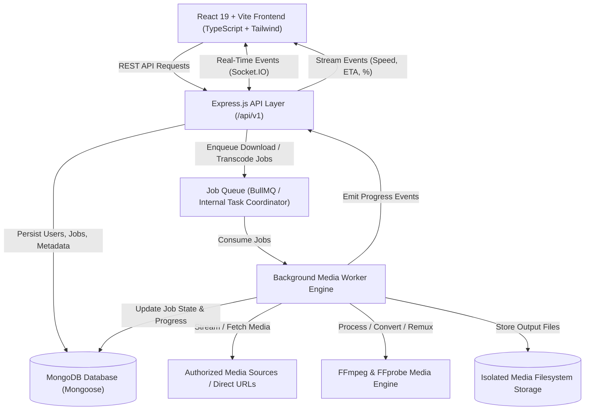

# System Architecture Document

## 1. Architectural Overview

VideoDownloader is built as a **modular monolith** with decoupled background workers. This architecture guarantees that long-running network operations, video streaming, and media transcoding do not block the Express HTTP request-response lifecycle.



---

## 2. Component Architecture

### 2.1 Frontend (`client/`)
* **Framework:** React 19 bootstrapped with Vite and TypeScript.
* **Styling:** Tailwind CSS with responsive design and theme support (dark/light).
* **State & Data Fetching:** TanStack Query (React Query) for server state caching and optimistic updates; React Context for auth/session state.
* **Real-time Client:** Socket.IO client subscribed to private user rooms (`user:<userId>`) for live progress feedback.
* **UI Modules:**
  * `components/layout/`: Navbar, Sidebar, Footer, Responsive Shell.
  * `components/auth/`: Login, Register, Session Guard, Protected Route.
  * `components/media/`: URL Inspector, Format Matrix Selector, Download Progress Card.
  * `components/library/`: Media Library, Collections, Player Modal, File Action Drawer.
  * `components/admin/`: System metrics, User management, Job monitor.

### 2.2 Backend (`server/`)
* **Runtime:** Node.js (v24 ESM) with Express and TypeScript.
* **Module Organization:**
  * `config/`: Environment variable validation with Zod (`env.ts`), database configuration.
  * `controllers/`: Request handling, validation integration, standard response formatting.
  * `routes/`: Express router declarations versioned under `/api/v1`.
  * `services/`: Core business logic:
    * `auth.service.ts`: Registration, hashing, token issuance, password resets.
    * `inspection.service.ts`: URL syntax validation, SSRF checks, source adapter routing.
    * `download.service.ts`: Job creation, status lifecycle, cancellation.
    * `queue.service.ts`: Queue dispatching and worker lifecycle management.
    * `storage.service.ts`: File persistence, retention cleanup, streaming handles.
    * `socket.service.ts`: Socket.IO authentication and event broadcasting.
  * `models/`: Mongoose schemas with strict TypeScript typing.
  * `middlewares/`: Centralized error handler, JWT authentication, rate limiting, request validation.
  * `adapters/`: Source adapters for media extraction (`DirectUrlAdapter`, `BaseAdapter`).
  * `workers/`: Background task runners executing downloads, FFmpeg remuxing, and file cleanup.

---

## 3. Asynchronous Job State Machine

Download jobs strictly adhere to the PRD state transition model:

```
  [ PENDING ] ────────► [ QUEUED ] ────────► [ PROCESSING ]
       │                      │                      │
       ▼                      ▼                      ▼
  [ CANCELLED ]          [ CANCELLED ]          [ DOWNLOADING ]
                                                     │
                                                     ▼
  [ FAILED ] ◄────────── (On Error) ─────────── [ CONVERTING ]
       │                                             │
       │ (Retry)                                     ▼
       └────────────────► [ QUEUED ]           [ COMPLETED ]
```

* **Backend as Single Source of Truth:** The frontend never transitions job state directly.
* **Atomic Transitions:** State changes are persisted to MongoDB and broadcast via Socket.IO to the user's room.

---

## 4. Security & Isolation Architecture

1. **SSRF (Server-Side Request Forgery) Defense:**
   * URLs submitted for inspection are resolved via DNS before connection.
   * Private, loopback (`127.0.0.1`, `localhost`), link-local (`169.254.x.x`), and RFC 1918 private subnets (`10.x.x.x`, `172.16-31.x.x`, `192.168.x.x`) are rejected immediately.
2. **Path Traversal Protection:**
   * Filesystem writes are confined to a designated `storage/` directory using strictly UUID-based filenames. User-facing filenames are stored only in metadata.
3. **Authentication & Token Lifecycle:**
   * Access tokens: Short-lived JWTs (15 minutes) passed via Authorization header or HTTP-only cookies.
   * Refresh tokens: Long-lived (7 days) stored in the database with rotation and revocation on logout.
4. **Rate Limiting & Abuse Prevention:**
   * Inspection endpoint: 30 requests per minute per IP.
   * Download creation: 10 jobs per minute per user.
   * Authentication endpoints: 5 attempts per 15 minutes per IP.

---

## 5. Storage Architecture & Retention

* **Storage Separation:** Binary media files are never stored in MongoDB.
* **Temporary Chunks:** Placed in `storage/temp/` and purged immediately upon job completion or failure.
* **Final Media:** Placed in `storage/media/` organized by user namespace: `storage/media/{userId}/{fileId}.{ext}`.
* **Retention Daemon:** A scheduled cleanup worker checks file age against retention rules (24-hour default for free/guest tier) and deletes expired binaries, updating MongoDB records accordingly.
